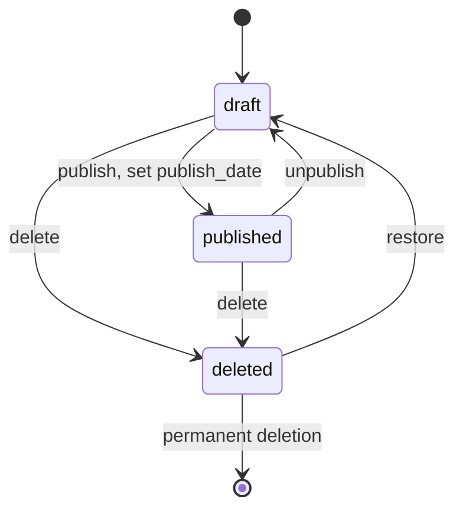

# ADR-001: Post Lifecycle State Transitions

## Status

Accepted

# Context

Posts have three lifecycle states:

- Draft
- Published
- Deleted

The API must allow for explicit transitions between these states while
maintaining predictable public visibility and ensuring that deleted posts can be
recovered. Explicit rules defining this lifecycle must be established so that
state changes do not occur accidentally through standard update operations.

## Decision

Lifecycle changes will be performed via explicit operations rather than standard
update operations.

The permitted transitions will be:

| Current   | Target    | Allowed |
| --------- | --------- | ------- |
| Draft     | Published | Yes     |
| Draft     | Deleted   | Yes     |
| Published | Draft     | Yes     |
| Published | Deleted   | Yes     |
| Deleted   | Draft     | Yes     |
| Deleted   | Published | No      |

A deleted post must first be restored before it can be published again.

The publication date will be assigned when a post transitions to "published" for
the first time.

If a published post is reverted to "draft" and subsequently published again, its
existing publication date will be retained unless the implementation defines a
separate republication policy.

Deleted posts will remain in the database and can be recovered until they are
permanently removed by the retention mechanism.

### State machine

The post lifecycle is represented by the following state machine:

## Consequences

### Positive

- Lifecycle rules are explicit and testable.
- Restoring a deleted post cannot accidentally make it publicly visible.
- Ordinary post updates cannot bypass lifecycle rules.
- Each transition can have dedicated authorization and validation.
- The API can return meaningful errors for invalid transitions.

### Negative

- Lifecycle operations require additional API logic.
- The implementation needs explicit transition validation.
- Additional tests are required for valid and invalid transitions.

### Alternatives Considered

#### Allow every state transition

Rejected because allowing Deleted → Published directly could make a restored
post publicly visible without an intermediate review state.

#### Allow status changes through ordinary update operations

Rejected because lifecycle changes have different semantics from modifying
normal post content and should therefore have their own validation and
authorization rules.
